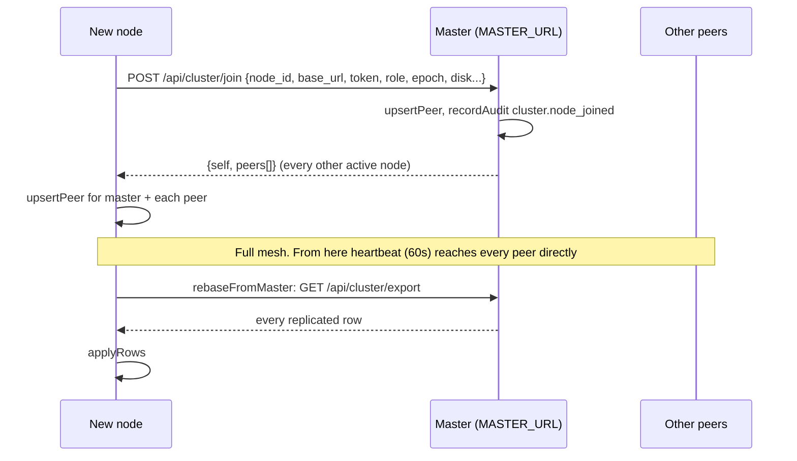
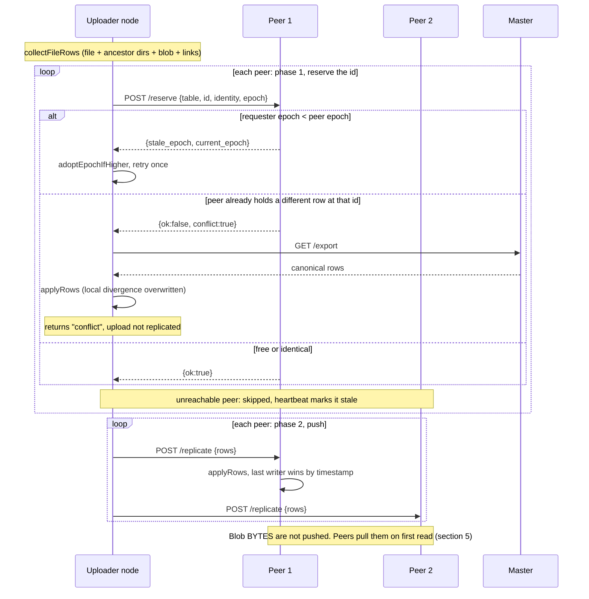
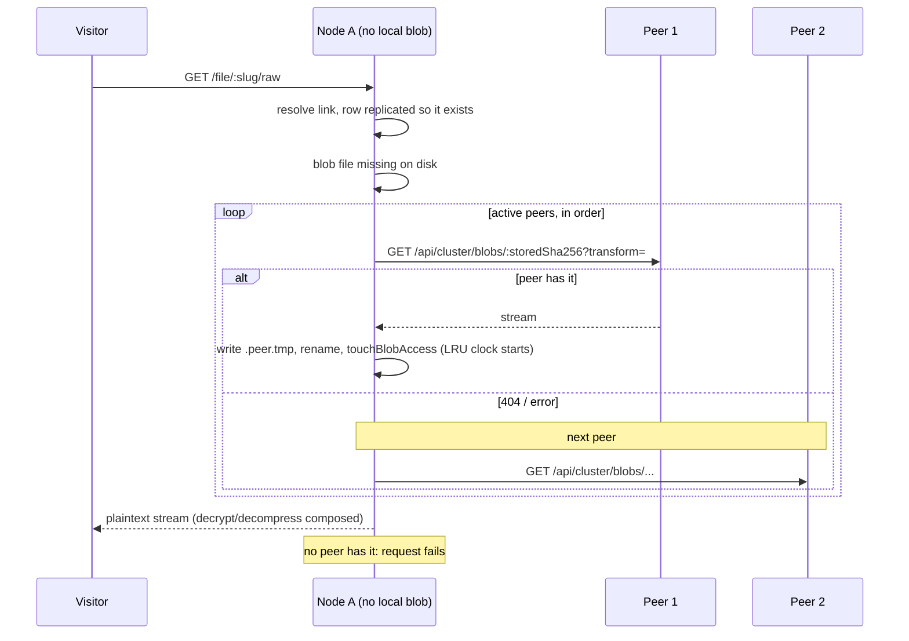
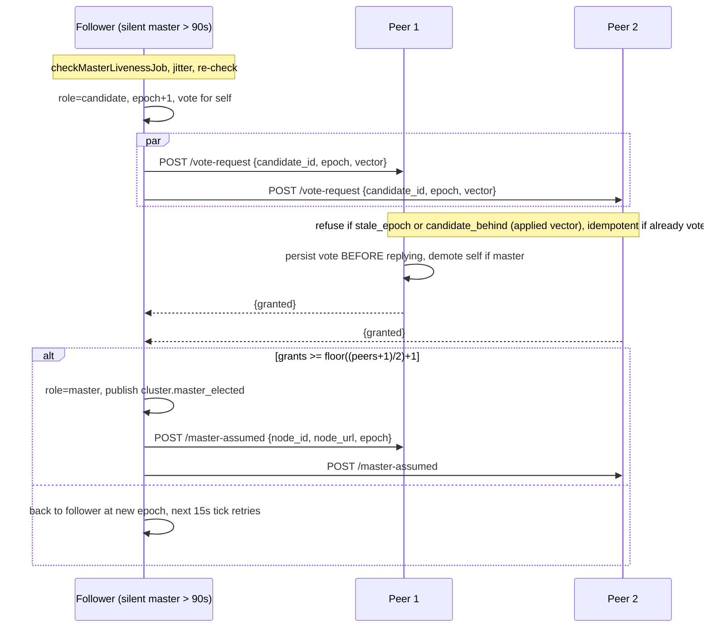
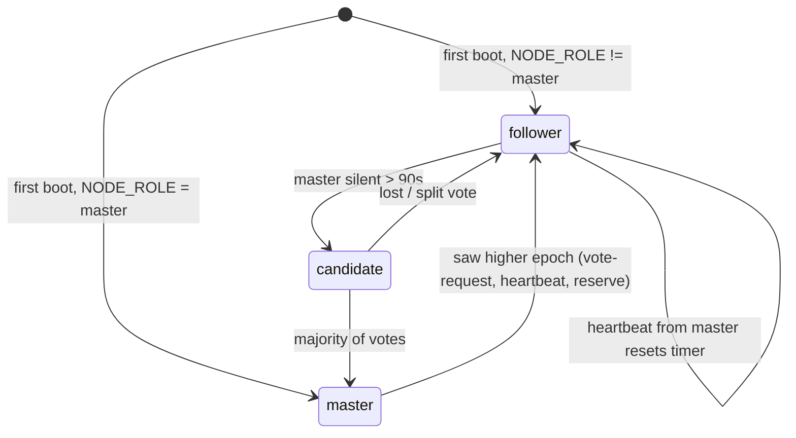
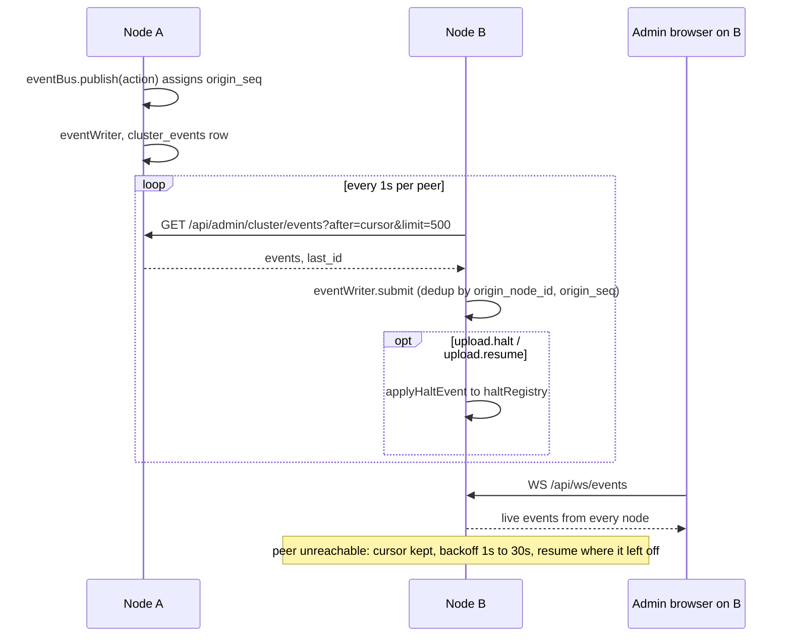

# Cluster flows — what a node does, and who it talks to

What the code does **today** (`server/src/cluster/*`, `routes/cluster.ts`, `jobs/scheduler.ts`). The
target design is in `cluster-redesign.md`; this is not it. Diagrams are Mermaid and render on GitHub.

All node-to-node HTTP is `Authorization: Bearer <cluster token>` via `cluster/http.ts`, except the
websocket firehose, which is token-authed at upgrade in `ws.ts`.

> Live version of all this: **Cluster → Activity** in the UI. It traces only while the tab is open and
> Live is on (`cluster/activity.ts`).

## 1. One node, everything running

```mermaid
flowchart LR
  subgraph clients[Clients]
    B[Browser / API key]
    PW[Peer node]
  end

  subgraph node[This node: one Bun process, one app.listen]
    direction TB
    EX[Express]
    WS[ws.ts upgrade handler]
    BUS[(eventBus<br/>in-memory, origin_seq)]
    STORE[(cluster_events<br/>UNIQUE origin_node_id, origin_seq)]
    DB[(SQLite)]
    BLOB[(data/storage)]
    HALT[haltRegistry<br/>TTL map]
    SCH{{scheduler.ts<br/>setInterval jobs}}
    FH[ClusterFirehoseConsumer<br/>one poller per peer]
  end

  B -->|/api/*| EX
  B -->|/api/ws/events<br/>session cookie| WS
  PW -->|/api/cluster/* cluster token| EX
  PW -->|/api/admin/cluster/firehose| WS

  EX --> DB
  EX --> BLOB
  EX -->|publish| BUS
  BUS --> STORE
  BUS --> WS
  BUS -. upload.halt .-> HALT

  SCH -->|60s heartbeatJob| PW
  SCH -->|15s checkMasterLivenessJob| PW
  SCH -->|5m syncCheckJob| PW
  SCH -->|10m cacheEvictionJob| PW
  FH -->|1s GET /api/admin/cluster/events?after=cursor| PW
  FH -->|submit| STORE
  FH -. upload.halt / resume .-> HALT
```

## 2. Scheduled jobs (cluster ones)

| Job | Every | Talks to | Does |
|---|---|---|---|
| `cluster_heartbeat` | 60 s | `POST /heartbeat` on every known peer | refresh disk/role/epoch, mark unreachable `active=0`, learn higher epochs, reset master-silence timer |
| `cluster_election_liveness` | 15 s | nobody, unless it calls an election | if follower and silent > 90 s: jitter 0–1.5 s, re-check, `runElection` |
| `cluster_sync_check` | 5 min | `GET /digest` on active peers | compare hashes → `cluster.sync_mismatch`; two masters at one epoch → `cluster.split_brain_detected` |
| `cluster_cache_eviction` | 10 min | `confirmedElsewhere` against a `full` peer | `REPLICATION_MODE=cache` only: LRU-delete blobs over `CACHE_MAX_BYTES`, never the only copy |
| firehose reconcile | 5 s | — | start/stop one poller per active peer; each polls every 1 s, backs off ×2 up to 30 s |

## 3. Joining



## 4. A file upload replicating (announce-id protocol)

Runs after `finalizeStoredFile` on the node that took the upload. Best-effort; a no-op with no peers.



## 5. A download on a node that lacks the bytes

`routes/public.ts` raw/preview → `storage/streaming.ts` → `fetchBlobFromPeers`.



## 6. Leader election

Epoch-versioned; every write is fenced on epoch. Leadership traffic deliberately does **not** go over
the firehose.



Node role state:



## 7. Events and halts (the firehose)



`broadcastHalt` is how "stop uploads" spreads: set locally with a TTL (default 300 s), publish a
`control` event, peers apply it on their next poll. Worst-case spread is about 1 s plus poll latency.

## 8. Which endpoint is which

| Endpoint (`/api/cluster`) | Caller | Part of |
|---|---|---|
| `POST /join` | new node → master | join |
| `POST /heartbeat`, `GET /ping` | scheduler | liveness, epoch gossip |
| `GET /digest` | scheduler | drift and split-brain check |
| `POST /reserve`, `POST /replicate` | uploader | announce-id replication |
| `GET /export` | any node that diverged or joined | rebase from master |
| `GET /blobs/:sha` | any node that missed a read | blob fetch-on-miss, cache confirm |
| `POST /vote-request`, `POST /master-assumed` | candidate | election |
| `GET /api/admin/cluster/events`, `WS /firehose`, `GET /node-logs` | peers, admin UI | events, remote logs |
